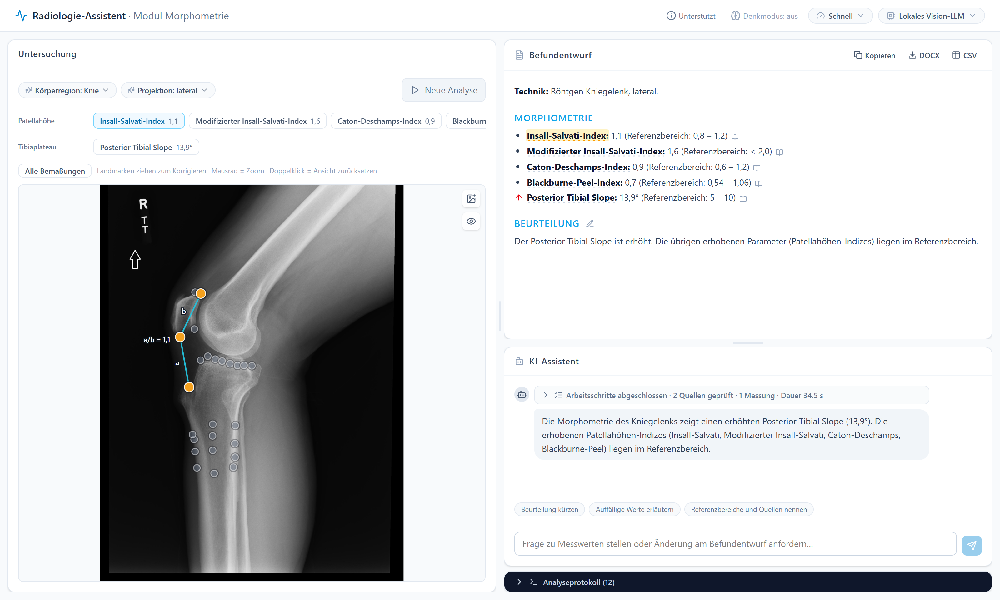

<h1 align="center">Radiograph Morphometry Agent</h1>

<p align="center">
  An LLM agent that drafts structured reports for musculoskeletal radiographs,
  grounded in automated morphometry and retrieved guideline text.
</p>

<p align="center">
  <a href="https://truhnlab.github.io/RadiographMorphometryAgent/"><b>Project Page</b></a>
</p>

<p align="center">
  
</p>

> [!NOTE]
> **Work in progress.** This is an ongoing research project and not a medical device.
> A reader study with radiologists is coming soon.

## Overview

The agent connects three services:

- a **language model** (any OpenAI-compatible vision model) that runs the case and writes
  the report
- a **morphometry service**
  ([RadiographLandmarkMatching](https://github.com/TruhnLab/RadiographLandmarkMatching))
  that places the landmarks and computes every measurement
- a **guideline search** (your own retrieval system or a folder of text files) that
  supplies every reference range

The language model never supplies a number or a threshold of its own. The radiologist can
correct landmarks, and the report follows.

## Getting started

You need Python 3.11+, Node.js 18+ and access to the three services above.

```bash
pip install -r requirements.txt
cp .env.example .env        # model, guideline search and morphometry service
python run.py               # open http://localhost:5173
```

Each service is configured in `.env` and can be replaced, see
[docs/configuration.md](docs/configuration.md). The interface and the reports are in German.

## Citation

A paper on the agent is in preparation. Until then, please cite the morphometry framework:

```bibtex
@article{eschweiler2026landmark,
  title   = {An Artificial Intelligence Framework for Universal Landmark Matching and Morphometry in Musculoskeletal Radiography},
  author  = {Eschweiler, Dennis and Cornejo Merodio, Eneko and Barajas Ordonez, Felix and Lichev, Aleksandar and Ignatova, Nikol and von der St{\"u}ck, Marc Sebastian and Kuhl, Christiane and Truhn, Daniel and Nebelung, Sven},
  journal = {European Radiology},
  year    = {2026},
  doi     = {10.1007/s00330-026-12555-y}
}
```
