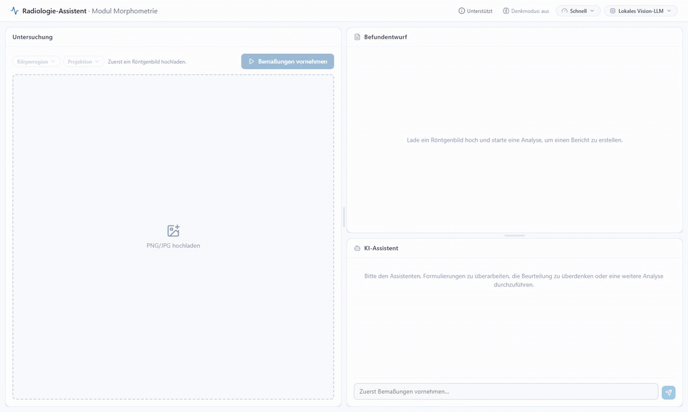
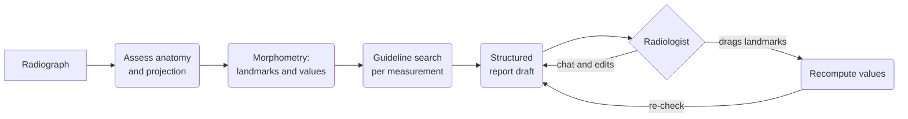

<h1 align="center">Radiograph Morphometry Agent</h1>

<p align="center">
  An LLM agent that drafts structured reports for musculoskeletal radiographs,<br>
  grounded in automated morphometry and retrieved guideline text.
</p>

<p align="center">
  
</p>

> [!NOTE]
> **Work in progress.** This is an ongoing research project. The code changes often, and the
> system is currently being evaluated by radiologists. It is not a medical device and must
> not be used for clinical decisions.

## Overview

Measuring a radiograph is only half of a report. The values then have to be compared with
reference ranges from the literature, interpreted, and written up. This project explores
whether a language model can take over that second half without becoming a source of
facts itself.

The model acts as an orchestrator. It identifies anatomy and projection, calls a
morphometry service for the measurements, searches a guideline corpus for the reference
range of each one, and writes a structured draft. It decides what to do next, but it never
supplies a number or a threshold of its own.

- **Measurements** come from [RadiographLandmarkMatching](https://github.com/TruhnLab/RadiographLandmarkMatching),
  a training-free landmark matching framework for musculoskeletal radiographs.
- **Reference ranges** come only from passages returned by the guideline search. A
  measurement without a supporting passage is reported as a bare value and left
  uninterpreted.
- **The radiologist stays in control.** Predicted landmarks can be dragged and the
  measurements follow live. A re-check then shows whether the correction changes any
  finding. The impression can be edited, and reference ranges can be given in the chat.

<p align="center">
  
</p>

## How it works



Every step appears in the interface as it happens, including the retrieved passages, so
each statement in a draft can be traced back to its source. The report lines that carry
numbers are rendered by code from the tool output rather than written by the model, so
prose and values cannot drift apart.

## Evaluation

We are evaluating the assistant together with radiologists in preparation for a
publication. In a reader study, radiologists report the same cases with and without the
assistant, and both are compared with fully automated drafts. The questions behind it are
simple. Are the drafts faithful to the measurements and to the literature? Do their
conclusions agree with routine clinical reporting? And do they hold up when a different
language model sits at the centre? Results will be linked here once they are published.

## Getting started

The assistant connects three services, and each of them can be replaced. See
[docs/configuration.md](docs/configuration.md) for the details.

| Service | Works out of the box with | Can be replaced by |
|---|---|---|
| Language model | a local vision model via Ollama | vLLM, LiteLLM or any OpenAI-compatible API |
| Guideline search | a small demo corpus of Markdown files | your own files, an MCP server or an HTTP endpoint |
| Morphometry | the RadiographLandmarkMatching service on a GPU | any service that speaks the same protocol |

1. Set up the morphometry service as described in
   [RadiographLandmarkMatching/docker](https://github.com/TruhnLab/RadiographLandmarkMatching/tree/main/docker).
   It needs annotated reference radiographs for each anatomy and projection you want to
   measure.
2. Install and start the assistant (Python 3.11+, Node.js 18+):

```bash
git clone https://github.com/TruhnLab/RadiographMorphometryAgent.git
cd RadiographMorphometryAgent
pip install -r requirements.txt
cp .env.example .env        # then enter your model and morphometry service
python run.py               # open http://localhost:5173
```

`python run.py serve` builds the interface once and serves everything on a single port.
There is no login, so keep the app on a closed network.

The interface, prompts and reports are in German, the language of the clinical setting the
assistant was built for.

## Repository layout

| Path | Contents |
|---|---|
| `agent.py` | the agent loop: runs the model's actions and keeps the report consistent with the tool output |
| `api.py` | FastAPI backend that streams every step to the interface |
| `guidelines/` | guideline search backends and the demo corpus |
| `tools/` | morphometry client and the curated measurement registry |
| `frontend/` | React interface (Vite, TypeScript, Tailwind) |
| `plugins/` | optional extensions, for example to record reader studies |

## Citation

A paper on the assistant is in preparation. Until then, please cite the morphometry
framework it builds on:

```bibtex
@article{eschweiler2026landmark,
  title   = {An Artificial Intelligence Framework for Universal Landmark Matching and Morphometry in Musculoskeletal Radiography},
  author  = {Eschweiler, Dennis and Cornejo Merodio, Eneko and Barajas Ordonez, Felix and Lichev, Aleksandar and Ignatova, Nikol and von der St{\"u}ck, Marc Sebastian and Kuhl, Christiane and Truhn, Daniel and Nebelung, Sven},
  journal = {European Radiology},
  year    = {2026},
  doi     = {10.1007/s00330-026-12555-y}
}
```

## License

MIT, see [LICENSE](LICENSE). The demo guideline corpus is meant for trying the software and
is not clinical guidance.
